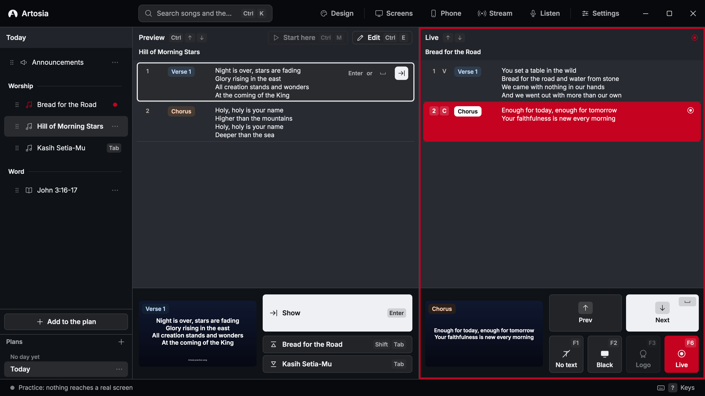

# Artosia

Artosia puts song words, Bible verses and announcements on a church's projector. It is free and built for the old Windows PC at the back of the hall. It replaces EasiSlides at the church it was written for, and reads that program's song library.



## What it does

| | |
|---|---|
| One window | The plan on the left, what comes next in the middle, what the room sees on the right |
| Preview is safe | Only Show, Enter and Next put a slide in front of the room. The Live tile switches the projector off and on |
| A plan per service | Morning, Sunday school and afternoon each keep their own list, and a plan can have its own background |
| One search | Songs by title or by any line, with typos forgiven. Bible references. Every command, so nothing needs the mouse |
| Keyboard | Up and Down move through the slides, as in EasiSlides. C jumps to the chorus, a digit to that section. `?` lists every key |
| Backdrops | 318 free photos and looping videos from Wikimedia Commons, fetched one at a time when chosen |
| Projector | A second screen is found and filled by itself. Its program is separate, so the words stay up if the operator window stops |
| Announcements | Slides that loop before the service, typed in or brought in from a PowerPoint file or a birthday list |
| Phone | A web page on the same Wi-Fi moves the slides |
| Languages | English and Indonesian |
| Updates | Each copy fetches the newest release by itself and checks its signature |

## Getting it

The homepage, in English and Indonesian: [artosia.matsuokengo.com](https://artosia.matsuokengo.com).

1. Download [Artosia-setup.exe](https://github.com/kengomatsuo/artosia/releases/latest/download/Artosia-setup.exe).
2. Open it. Windows may warn about an unknown publisher the first time: the programs are not code-signed.
3. It fetches Artosia, adds it to the desktop and the Start menu, and opens it.

For a computer with no internet, take [Artosia-windows.zip](https://github.com/kengomatsuo/artosia/releases/latest/download/Artosia-windows.zip), unzip it into a folder you can write to, such as Documents, and start `artosia.exe`. Program Files will not do, because Artosia updates its own files. [docs/setup.md](docs/setup.md) says what the setup does and how to remove Artosia.

Video and camera backgrounds and streaming run on the part of [GStreamer](https://gstreamer.freedesktop.org/) that comes in the `gstreamer` folder, so nothing else has to be installed. Its licences are in `gstreamer/licenses.zip`.

## Building

Rust comes from `rust-toolchain.toml`.

```bash
cargo build
cargo run -p artosia -- --practice
cargo test
```

`--practice` opens a made-up library with the projector off. The build with video needs GStreamer's development files; the variables are in [crates/artosia-video/README.md](crates/artosia-video/README.md).

## Where things stand

[docs/features.md](docs/features.md) says what is built and what was never tried on real hardware. [docs/architecture.md](docs/architecture.md) holds the decisions, [docs/operator.md](docs/operator.md) how the window works.

Macs and Linux are planned and untested. Only Windows has been built.

## Licence

GPL-3.0-or-later. See [LICENSE](LICENSE).
