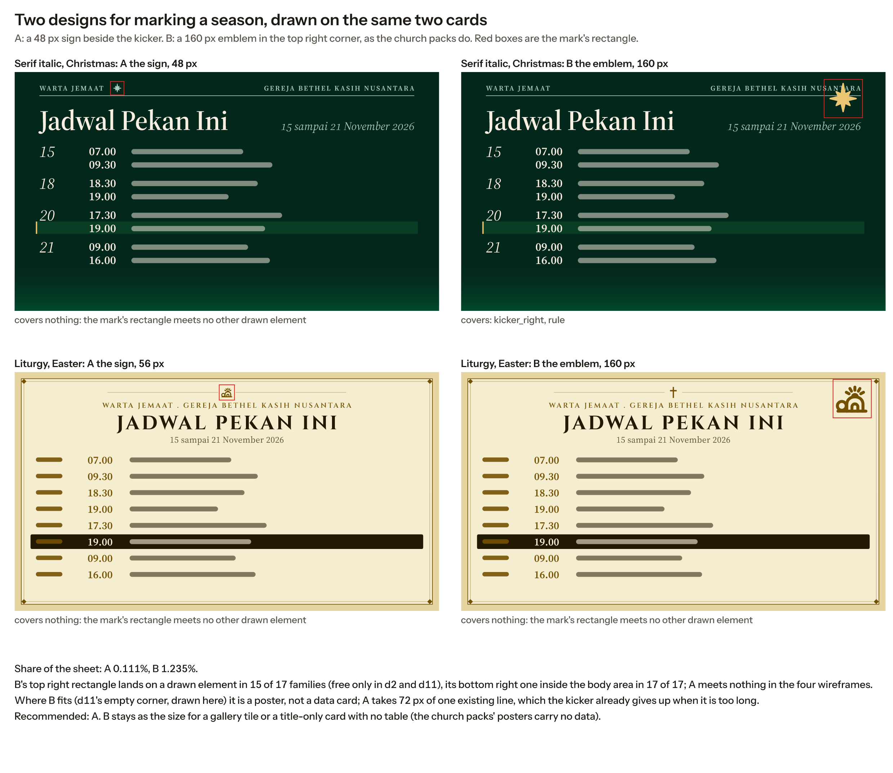
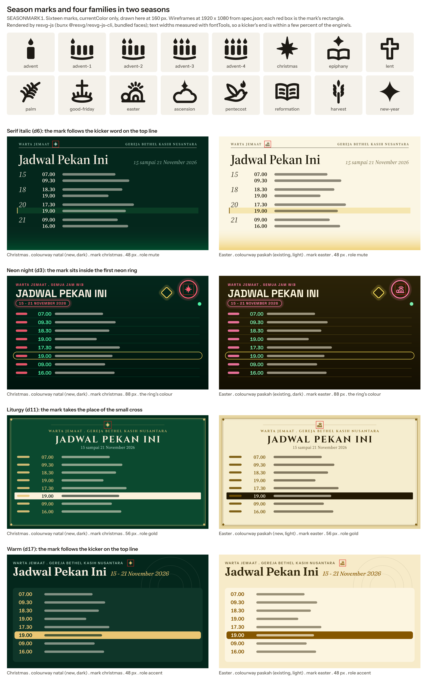
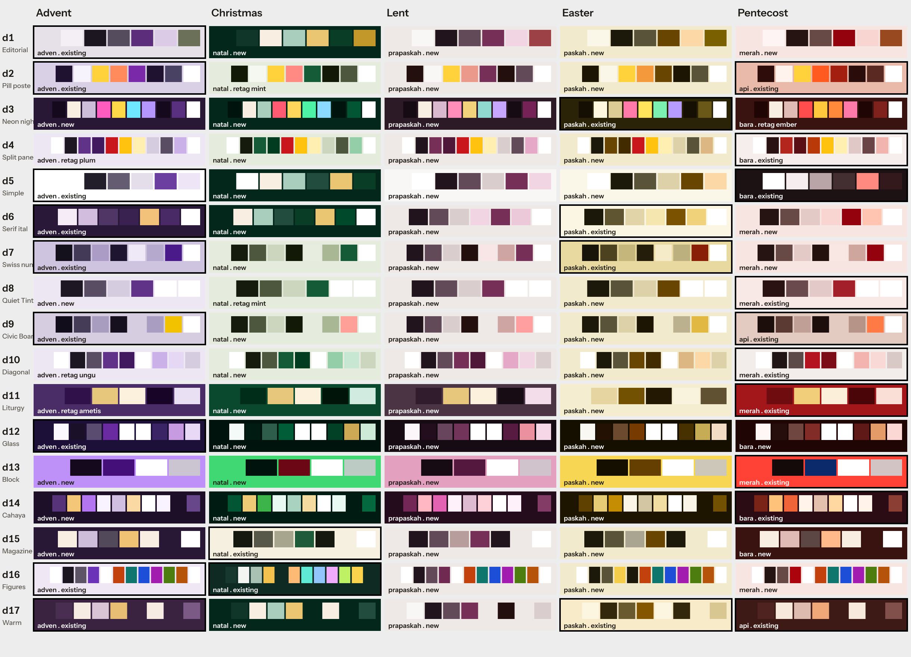

# Season marks and the missing seasonal colourways (SEASONMARK1)

Designer's plan, 2026-11-15, for card SEASONMARK1 (parent SEASONS1, `docs/church-year.md`; follows TPLCOLOURS1). Status: design for the owner to approve. No source code was changed; the only files written are under `docs/plans/artosia/seasons/` and this page.

Files, all under `docs/plans/artosia/seasons/`:

| File | What it is |
|---|---|
| `marks/<name>.svg` (16) | the twelve marks and the four Advent weeks, 24 unit grid, `currentColor` only |
| `marks/icons.rs.txt` | the same sixteen bodies as `Icon { view: 24.0, .. }` lines for the builder to paste; not compiled from here |
| `contact-sheet.png` | the twelve marks (and the four Advent weeks) at 160 px, and four families in Christmas and Easter with the mark placed |
| `marks-sizes.png` | all sixteen marks at 48, 64, 96 and 160 px on a light and a dark ground, and a stroke weight test |
| `designs-compare.png` | design A against design B on the same two cards |
| `colourways-sheet.png` | all 17 families by five seasons: the 60 new colourways beside the 25 already tagged |
| `wireframes/*.svg` | the ten wireframes at 1920 x 1080 (eight for the contact sheet, two for design B) |
| `colourways/d1.json` to `d17.json` | the new colourways of each family, ready to paste into its `colourways` list |
| `spec.json` | the build spec: grid, every glyph body, every placement, every palette and ratio, every wireframe element |
| `build/` | `glyphs.py`, `palettes.py`, `spec_data.py`, `wire.py`, `build.py`, `docs.py`, `check.py` and this page's template |

Renderer: resvg-js 2.6.2-beta.1 (`bunx @resvg/resvg-js-cli`, system fonts off, the bundled faces of `crates/artosia-slides/assets/warta/fonts`). Every sheet is composed as SVG and rendered once; no raster editor. Text widths in the wireframes come from fontTools advance widths without kerning, so a kicker's end is within a few percent of the engine's. The marks were rendered by resvg, not by Rune's own icon painter; `check.py` keeps them inside the subset that painter accepts (`crates/rune/src/text/icon.rs`) and the card's first test renders them through `icon_coverage`.

## 1. What the references say

The brief's finding holds on every cover read. Each source below is a file under `~/Shared/inspo/artosia-templates/seasons/` (row numbers are those of `notes.md`).

- GKI Bromo, Advent 1 and 2 (`yt-4Nzs8kJy2YU.jpg`, `yt--5cdDw3leRQ.jpg`, rows 8 and 9): one white candle icon after "MINGGU ADVEN 1", two the next week. The icon is 28 px on a 720 px cover (3.9%), as high as the caps beside it. The season's colour is the purple strip at the right quarter; the title and date stay plain type.
- GKI Kebayoran Baru, year start (`yt-3frYjkCRTs0.jpg`, row 164): a gold sparkle and a scalloped border on cream. The ornaments sit at the edge and the title is untouched.
- HKBP Tanjung Priok, Pentecost (`yt-SaBMHGmaESI.jpg`, row 129): a flame 4% of the slide stands in for the letter o. The whole motif is one swapped letter.
- The ash cross (`cvs-ash-wednesday-ministry-graphics.jpg`, row 46): the cross alone is the mark and the season.
- GBI Galaxi, Good Friday (`yt-FZXgpO9QgOY.jpg`, row 84): a crown of thorns behind the title. A mark cannot sit behind Artosia's data, so ours puts the crown at the foot of the cross.
- GKR Gedong (`yt-sRCenena5Kg.jpg`, row 156): wheat beside a thin frame, restrained. HKBP Taman Mini, Easter (`yt-TXsWxiCvxH0.jpg`, row 105): a lit cave mouth; the picture holds a robed figure, which our tomb leaves out.
- The over-full end, kept as counter-examples: HKBP Jambi (row 74), HKBP Jakarta (row 128), GKI Zaenal Zakse (row 73): many motifs and bank rows on one picture.

So a season is carried by three small things: a sign of about 4% of the height, a colour (a strip, a ground, an accent), and the data left clean. Artosia's colourways already carry the colour; this card adds the sign and the colours that are missing.

The brand page `docs/brand.md` is the Core Brand and was read first. Its Do not list (no cross, dove, flame, halo, open Bible, wheat in the mark) governs the Artosia logo, its wordmark and its lockups. These season marks are slide content: they never appear in a lockup or on the app icon, and they take palette roles, not the logo's black and white. No new brand page was written.

## 2. Two designs under two pulls

Both were drawn on the same two cards (`designs-compare.png`).



Pull A is "keep the data clean": a 48 px sign beside the kicker, the colourway carries the colour. Pull B is "make the season unmistakable from the back of the hall": a 160 px emblem in a corner, as the church packs do.

<!-- gen:compare -->
|  | A: the sign beside the kicker | B: the corner emblem |
|---|---|---|
| Size | 48 px (0.111% of the sheet), 56 px in d4 and d11, 60 to 88 px inside d3's ring | 160 px (1.235% of the sheet) |
| Meets a drawn element | none in the four wireframes (tightest clearance in `check.py` output below) | top right lands on a drawn element in 15 of 17 families, bottom right inside the body area in 17 of 17 (`spec.json` compare.rows) |
| Church practice | GKI Bromo's candle icon (yt-4Nzs8kJy2YU.jpg), the ash cross alone (cvs-ash-wednesday-ministry-graphics.jpg), a flame in place of a letter (yt-SaBMHGmaESI.jpg) | the church packs' corner motifs (notes.md rows 1, 2, 5, 21), all on title-only graphics that carry no table |
| Data kept clean | yes: it takes 72 px of the kicker line, which already gives way when a church name is long | no: it needs the corner the date range, the tag chip or the last rows already use |
| Cost to build | one `Item::Mark` on the Sheet and one token block per family (spot, size, role) | the same primitive plus a reflow of the body in every layout file |
| Families' written Never lists | one clause amended (d6); d7 to d9 keep theirs by having no mark | B is an icon too, at 3.3 times the size, in the four families whose lists ban icons (d6 to d9) |
| Verdict | recommended | kept only as the 160 px size for a gallery tile or a title-only card |
<!-- /gen:compare -->

Recommendation: A. B is not wrong, it is a poster size: it fits where the card has an empty corner (d11 and d2) and the church packs that use it carry no table. A keeps the six kinds as they are and costs one line of the kicker.

## 3. The twelve marks



**One line style.** A 24 unit grid with the live area from 2 to 22. Every outline is 2 units, round caps and joins, no fill. Two kinds of thing are solid, in the same colour: a light (flame, star, spark, the half sun) and anything under 5 units across (candle bodies, wheat grains). Nothing else is filled. There is one colour (`currentColor`), no opacity, no gradient, and only `path`, `rect`, `circle` and `ellipse` with the commands M L H V C Q A Z, which is what Rune's icon painter accepts. The weight was chosen on `marks-sizes.png`: 1.5 units is 3 px at 48 px beside a 32 px label whose stems are about 4.5 px, so it reads light; 2.5 closes the thorn crown, the wheat and the Bible's lines; 2 keeps every counter open.

**No faces, no figure.** The dove is the only creature. The tomb is empty. The Ascension has a cloud and a light, no feet and no figure. Nothing carries a halo, rays round a cross or a pair of sparkles.

<!-- gen:marks -->
| file in `marks/` | season code | what it draws | at 48 px |
|---|---|---|---|
| `advent.svg` | advent | one candle: a solid body 6.6 wide and a teardrop flame | reads: a candle with its flame |
| `advent-1.svg` | advent | four candles on a shallow tray, the first flame lit | reads: four candles, one flame; the count holds at 48 px |
| `advent-2.svg` | advent | the same row, two flames | reads: two flames |
| `advent-3.svg` | advent | the same row, three flames | reads: three flames |
| `advent-4.svg` | advent | the same row, four flames | reads: four flames |
| `christmas.svg` | christmas | an eight point star, the vertical points longest, solid | reads: a star at once |
| `epiphany.svg` | epiphany | an open book in outline with a solid four point light above it | reads: a book under a star |
| `lent.svg` | lent | a hollow Latin cross, beams 4 units wide | reads: a cross; the hollow stays open at 48 px |
| `palm.svg` | holy-week | one branch: a curved rachis and four pairs of leaflets | reads: a branch; at 48 px it is a leafy stroke, it needs its colour next to words |
| `good-friday.svg` | good-friday | a cross standing in a crown of thorns: a ring with five thorns on its far edge | reads: a cross standing in a ring of thorns |
| `easter.svg` | easter | a hill with an open door, the stone rolled aside, a half sun and five rays above | reads: a sunrise over a hill with a stone; the stone is the weakest part at 48 px |
| `ascension.svg` | ascension | a cloud in outline with a tall solid light rising out of it | reads: a cloud with a light above it |
| `pentecost.svg` | pentecost | a dove in outline (body and one raised wing) with a solid flame above its head | reads: a bird with a flame above it; the flame is a speck at 48 px, the bird carries it |
| `reformation.svg` | reformation | an open Bible in outline with two lines of text on each page | reads: an open book with lines of text |
| `harvest.svg` | by hand | one ear: a stem, three pairs of grains and a tip grain, all solid | reads: an ear of wheat |
| `new-year.svg` | by hand | a single solid four point spark | reads: a single spark |
<!-- /gen:marks -->

Hard choices, in the order they were met:

- Christmas is an eight point star, not five points (a five point star reads as a rating) and not the four point sparkle (it reads as a magic or AI sign today). New Year takes that sparkle alone, with no second one beside it. Epiphany and Ascension carry the same four point light, small over a book and tall over a cloud, so "light" has one shape across the set.
- Good Friday went through more than ten crowns. A ring of thorns fused with the cross read as a badge, a tilted ellipse read as an eye, a spiky band read as a zigzag. A flat ring with five thorns on its far edge and the cross standing in it reads as both objects at 48 px.
- Reformation is the open Bible with its lines of text. A cross standing on the book was drawn and dropped: it made Reformation and Epiphany the same shape (a book with something above it).
- Easter went through several tombs. A block with a door read as a house. The hill with the open door, the stone rolled aside and the sunrise reads as an Easter morning to a congregation that knows the story, and as a hut with a sun to one that does not. The sunrise is what keeps it from being a hut.
- Known weakness, shown on `marks-sizes.png`: at 48 px the Pentecost flame is a speck and the palm is a leafy stroke. The bird carries the first, the branch's diagonal the second. If the owner wants more at 48 px, the flame grows to 6 units wide and the dove loses its second wing line; that is a one line change in `build/glyphs.py`.

## 4. Which season draws which mark

<!-- gen:season_mark -->
| `Season::code()` | mark |
|---|---|
| advent | `advent-1` to `advent-4` by the week, `advent` |
| christmas | `christmas` |
| epiphany | `epiphany` |
| lent | `lent` |
| holy-week | `palm` |
| good-friday | `good-friday` |
| easter | `easter` |
| ascension | `ascension` |
| pentecost | `pentecost` |
| reformation | `reformation` |
| ordinary | none |
| harvest (not a season of the engine) | `harvest` by hand only |
| new-year (not a season of the engine) | `new-year` by hand only |
<!-- /gen:season_mark -->

- **Advent's week.** week n = 1 + whole weeks from the first Sunday of Advent to today (1 to 4); the fourth week runs to 24 December; a card in the advent colourway outside Advent draws the single candle, advent.svg. In 2026 the Sundays are 29 November, 6, 13 and 20 December.
- **Harvest and New Year** are not seasons of the engine (`Season` has eleven values, none of them these), so they are marks a person picks by hand. This card draws them and does not add a picker; the owner decides in section 9.
- **Epiphany, Holy Week, Good Friday, Ascension and Reformation** have a mark but no colourway (the brief names five seasons). Until they have one, a family without a tagged colourway keeps its own, as `colourway_for_season` does now.

## 5. Where each family puts its mark

14 of the 17 families carry a mark; d7, d8 and d9 do not. A mark never changes the six kinds' data: its colour role and ground are a pair the family already lists, so the existing contrast test guards it in every colourway, old and new.

<!-- gen:placement -->
| family | spot | px on the 1920 x 1080 sheet | role and ground | rule and reason |
|---|---|---|---|---|
| d1 Editorial greige | kicker | 48 | `accent` on `paper`, lowest 5.42:1 over every colourway | Left of the top line, right after 'Warta jemaat . church' (measured end + 24 px), centred on the kicker's line (y 96). The kicker line is the one line every kind of this family draws; a 2% sign beside a caps label is what GKI Bromo does (yt-4Nzs8kJy2YU.jpg). |
| d2 Pill poster | sticker | 48 | `ink` on `orange`, lowest 5.83:1 over every colourway | A round orange sticker 72 px across at the right end of the pill row (centre x2-36, y 84), the mark 48 px in ink inside it. Pill poster already speaks in round stickers (the KHUSUS stamp and the DAFTAR disc, d2.rs lines 22 and 105); the mark rides one more, in the top corner nothing else uses. |
| d3 Neon night | ring | 50% of the ring (88, 75 or 60) | the ring's colour (pink, yellow or teal) on `night1`, lowest 5.06:1 over every colourway | Inside the first neon ring of the kind with a diameter of 200 px or less, centred, 50% of the ring's diameter (S01 88, S04 75, S06 60 px), in the ring's own colour. The ring is empty decoration (d3.json deco); a season mark inside it adds nothing to the slide and the ring's colour already passes the 3:1 mark pair on night1. |
| d4 Split panel | panel | 56 | `sky` on `navy`, lowest 7.03:1 over every colourway | In the top right corner of the navy area, 56 px, at x2-56 and y 40, in sky. Where the kind has no navy at the top right (verse, notice with a picture) it sits after the kicker in blue, 48 px. The navy panel is already a side strip in the season's colour (d4.rs ground()); the mark is a corner sign on that strip, as GKI Bromo puts the pastor circle on its purple strip (yt--5cdDw3leRQ.jpg). |
| d5 Simple | kicker | 48 | `accent` on `paper`, lowest 4.51:1 over every colourway | After the church name on the top line (measured end + 24 px), centred on y 88; the church name's maxw is lowered by 72. Plain ground, one line on top; the quietest place a sign can go (sgo-ash-wednesday.jpg: a small cross on a hairline). |
| d6 Serif italic | kicker | 48 | `mute` on `paper`, lowest 5.74:1 over every colourway | After 'Warta jemaat' on the top line (measured end + 24 px), centred on the cap height of the kicker (baseline 84, so y 73); mute, never accent. The default look. The mark is set like a fleuron: same colour as the caps label, 9 px clear of the rule at y 106, accent kept for the highlight. Amends: templates-default.md candidate A says 'no icon'. This card amends it by one clause: no icon except the season mark, in mute, beside the kicker. Alternative if the owner refuses: no mark, the wash alone. |
| d7 Swiss numerals | none | - | - | No mark. The colourway (block, accent) carries the season. Swiss numerals says no icon, no rounded shape, one accent only for the highlight and the total (templates-default.md candidate B). A round-capped sign breaks all three. |
| d8 Quiet Tint | none | - | - | No mark. The tinted ground and the pill carry the season. Quiet tint says no icon and no second accent (templates-default.md candidate C); its pill is the only coloured shape. |
| d9 Civic Board | none | - | - | No mark. The black band and its accent carry the season. Civic board says no icon and no rounded corner (templates-default.md candidate D); a departure-board header takes no pictogram. |
| d10 Diagonal | kicker | 48 | `sky` on `brand_dk`, lowest 6.21:1 over every colourway | After the kicker on the header block (measured end + 24 px), centred on y 62; the header's room() is lowered by 72. The kicker sits on the deep block in sky; the sign takes the same ink, so it is already a tested pair (sky on brand_dk). |
| d11 Liturgy | cross | 56 | `gold` on `ground`, lowest 5.14:1 over every colourway | Replaces the small cross between the two gold rules: centred at (960, 92), 56 px, gold. The rules keep their ends 40 px from the centre, so the 80 px gap holds it. The family's only pictogram is that cross (d11.json cross_*); a season swaps it for the season's sign and draws it again when no season applies. |
| d12 Glass | kicker | 48 | `white` on `scrim`, lowest 16.00:1 over every colourway | After the kicker on the photo (measured end + 24 px), centred on y 72, white at the kicker's 90% opacity. Words on the photo sit on a scrim; the sign takes the kicker's own white, so it is as safe as the words. |
| d13 Block | kicker | 48 | `deep` on `signal`, lowest 5.63:1 over every colourway | After the kicker on the signal band (measured end + 24 px), centred on y 56, in deep. Hard blocks, one mark on the band beside the label, in the same near-black the label has. |
| d14 Cahaya | kicker | 48 | `accent` on `g2`, lowest 6.06:1 over every colourway | After the kicker (measured end + 24 px), centred on y 84, in accent. Accent on g2 is already one of the family's listed mark pairs. |
| d15 Magazine | kicker | 48 | `accent` on `ground`, lowest 5.66:1 over every colourway | After 'Warta jemaat' in the top left folio line (measured end + 24 px), centred on y 56; the church name at the right is left out when it no longer fits, as it already is. A magazine folio line carries a small ornament; accent on ground is a listed mark pair. |
| d16 Figures | corner | 48 | `ink` on `ground`, lowest 13.90:1 over every colourway | At the right end of the top row, right edge at x2, centred on y 50 (the kicker stays at y 38; the chip below starts at y 89); the kicker's maxw is lowered by 72. The kicker row is only 54 px under the top edge, so a sign beside it would leave the title-safe area; the right corner above the chip is empty in every kind. |
| d17 Warm | kicker | 48 | `accent` on `ground`, lowest 5.12:1 over every colourway | After the kicker (measured end + 24 px), centred on y 80; the arches at the right stay behind nothing. Warm tone-on-tone with one accent; the arches rise at the right, so the left of the kicker line is free. |
<!-- /gen:placement -->

- **One new primitive.** The renderer's `Sheet` holds `Item::Rect`, `Item::Image` and `Item::Text` (`crates/artosia-slides/src/warta/mod.rs` line 351); `R` has no path and `Pic` is raster. The mark needs one new item, `Item::Mark`, that draws an `Icon` at a position, size and role colour, through the same painter the operator window uses. That is the lowest rung of the creation ladder that holds.
- **"Beside the kicker" means measured.** Every layout already measures its kicker (`sl.text(..)` returns `.w`). The mark is placed at `x = kicker.x + kicker.w + gap` and the kicker's `maxw` is lowered by `size + gap` (72 px) first, so a long church name shortens before the mark is ever dropped.
- **d6 is an exception to its own rule.** `templates-default.md` candidate A says "no icon". The mark is set as a fleuron: the kicker's own colour (`mute`), 9 px clear of the rule, accent left to the highlight. This card amends that clause by one: no icon except the season mark. If the owner refuses, d6 uses the wash alone (section 9).
- **d7, d8, d9 have no room.** Their Never lists ban icons, and d7 and d9 are hard edged; a round capped sign breaks them. Their colourway (block and accent, tinted ground and pill, black band and accent) carries the season. The fallback spot if the owner overrules is in `spec.json` (`placement.fallback_if_overruled`).

## 6. Seasonal colourways

Method. Each season has one paint box in OKLCH, light and dark (`build/palettes.py`, copied to `spec.json` `paint`). A family maps its own palette keys to the box's roles, so a new colourway has the family's keys and its structure. A solver then moves lightness, never hue, until every pair the family lists passes with 0.05 to spare. The gates are the Rust test's: text 4.5, large and mark 3, WCAG 2 luminance with the 0.03928 threshold as `look.rs` computes it.

<!-- gen:paint -->
| season | colours | light: ground, accent, tint | dark: ground, accent, ink | new colourways drawn light |
|---|---|---|---|---|
| Advent | violet and candle gold | `#EDE6F3` `#603288` `#E4D8F4` | `#291736` `#F0C374` `#F8EFE2` | light: d4, d8, d10 |
| Christmas | evergreen, holly red and gold | `#E6ECDD` `#165B38` `#C7E7D2` | `#04271C` `#EAC673` `#F8EFE2` | light: d2, d4, d7, d8, d9, d10 |
| Lent | ash and mulberry | `#EEE8E7` `#763058` `#F1D5E2` | `#2C1A26` `#F7B7C1` `#F8EFE2` | light: d1, d2, d4, d5, d6, d7, d8, d9, d10, d15, d16, d17 |
| Easter | ivory and bronze gold | `#F2EACC` `#684500` `#FBD8A6` | `#291F00` `#E7C869` `#F8EFE2` | light: d1, d2, d4, d5, d8, d9, d10, d11, d15, d16 |
| Pentecost | red and flame | `#F7E5E2` `#94020D` `#F8D5D0` | `#38130F` `#FFB98A` `#F8EFE2` | light: d1, d6, d7, d16 |
<!-- /gen:paint -->

Choices that are not obvious:

- **Advent and Lent are both violet in a church, so they differ in chroma and hue.** Advent is a clear violet (hue 306) with candle gold; Lent is ash with mulberry (hue 348) on a ground with almost no tint (chroma 0.007 against Advent's 0.018).
- **Christmas is evergreen with gold on a dark ground, cream with evergreen and holly red on a light one.** Dark families draw it dark: a green ground with gold or cream on it, as GPdI Bulak Sereh and HKBP Menteng do (rows 33 and 37). Red and green are also the two Christmas colours of rows 27 and 28.
- **Easter is ivory and bronze gold on a light ground**, gold on a dark olive ground in the dark families (as d3's existing `paskah`). d11 turns ivory: its vestment ground becomes ivory, its frame deep gold and its bands dark with ivory words, which is the liturgical white and gold. The keys keep their names and their listed pairs; only their lightness flips.
- **Pentecost is red with a flame orange** (hue 27 and 45), light on rose paper, dark on ember.
- **6 of the 60 gaps are already a colourway the family ships untagged** (swatch distance under 0.05 and the same hue). Adding a copy would put two near identical tiles in the gallery, so for those the recommendation is a one word edit, not a new look. The new palette is still in `colourways/dN.json` as the alternative.

<!-- gen:retag -->
| file | edit | swatch distance (OKLab) | note |
|---|---|---|---|
| d2.json | `{"id":"mint",` becomes `{"id":"mint","season":"christmas",` | 0.047 | `natal` below stays as the alternative if a dedicated look is wanted |
| d3.json | `{"id":"ember",` becomes `{"id":"ember","season":"pentecost",` | 0.036 | `bara` below stays as the alternative if a dedicated look is wanted |
| d4.json | `{"id":"plum",` becomes `{"id":"plum","season":"advent",` | 0.037 | `adven` below stays as the alternative if a dedicated look is wanted |
| d8.json | `{"id":"mint",` becomes `{"id":"mint","season":"christmas",` | 0.039 | `natal` below stays as the alternative if a dedicated look is wanted |
| d10.json | `{"id":"ungu",` becomes `{"id":"ungu","season":"advent",` | 0.038 | `adven` below stays as the alternative if a dedicated look is wanted |
| d11.json | `{"id":"ametis",` becomes `{"id":"ametis","season":"advent",` | 0.049 | `adven` below stays as the alternative if a dedicated look is wanted |
<!-- /gen:retag -->

With the retags, 54 new colourways are added and the library goes from 105 to 159 templates. Append each new colourway at the end of its list, so existing ids and the first colourway (the family's own design) do not move.

<!-- gen:counts -->
| family | already tagged | gaps filled below | tag an existing colourway instead |
|---|---|---|---|
| d1 Editorial greige | advent | christmas, lent, easter, pentecost | - |
| d2 Pill poster | advent, pentecost | christmas, lent, easter | mint to christmas |
| d3 Neon night | easter | advent, christmas, lent, pentecost | ember to pentecost |
| d4 Split panel | pentecost | advent, christmas, lent, easter | plum to advent |
| d5 Simple | advent, pentecost | christmas, lent, easter | - |
| d6 Serif italic | advent, easter | christmas, lent, pentecost | - |
| d7 Swiss numerals | advent, easter | christmas, lent, pentecost | - |
| d8 Quiet Tint | pentecost | advent, christmas, lent, easter | mint to christmas |
| d9 Civic Board | advent, pentecost | christmas, lent, easter | - |
| d10 Diagonal | pentecost | advent, christmas, lent, easter | ungu to advent |
| d11 Liturgy | pentecost | advent, christmas, lent, easter | ametis to advent |
| d12 Glass | advent | christmas, lent, easter, pentecost | - |
| d13 Block | pentecost | advent, christmas, lent, easter | - |
| d14 Cahaya | pentecost | advent, christmas, lent, easter | - |
| d15 Magazine | christmas | advent, lent, easter, pentecost | - |
| d16 Figures | advent, christmas | lent, easter, pentecost | - |
| d17 Warm | advent, easter, pentecost | christmas, lent | - |
<!-- /gen:counts -->



How to read each family below: the snippet is the new colourways in the order advent, christmas, lent, easter, pentecost (gaps only), one object per line, each with a trailing comma; paste them after the last entry of `colourways` (drop the last comma if it ends the list). The table gives the ratio of every pair the family lists, in the same order as its `pairs`.

### d1 Editorial greige

<!-- gen:cw1 -->
**Mark:** 48 px, `accent`, after the kicker. **Tagged already:** advent `adven`. **Gaps:** christmas, lent, easter, pentecost.

```json
{"id":"natal","season":"christmas","palette":{"paper":"#04271C","card":"#0F3629","ink":"#F8EFE2","mute":"#A9CEBE","accent":"#EAC673","tint":"#0A3D25","sage":"#C2982A"}},
{"id":"prapaskah","season":"lent","palette":{"paper":"#EEE8E7","card":"#F9F6F6","ink":"#22141D","mute":"#624A59","accent":"#763058","tint":"#F1D5E2","sage":"#9C4246"}},
{"id":"paskah","season":"easter","palette":{"paper":"#F2EACC","card":"#FBF7E8","ink":"#1D190A","mute":"#595339","accent":"#684500","tint":"#FBD8A6","sage":"#7A6001"}},
{"id":"merah","season":"pentecost","palette":{"paper":"#F7E5E2","card":"#FDF4F3","ink":"#251412","mute":"#674A45","accent":"#94020D","tint":"#F8D5D0","sage":"#994920"}},
```

| pair (text 4.5, large and mark 3) | gate | christmas `natal` | lent `prapaskah` | easter `paskah` | pentecost `merah` |
|---|---|---|---|---|---|
| `ink` on `paper` | text 4.5 | 14.05 | 14.62 | 14.57 | 14.54 |
| `mute` on `paper` | text 4.5 | 9.34 | 6.56 | 6.40 | 6.53 |
| `accent` on `paper` | text 4.5 | 9.77 | 7.43 | 7.14 | 7.59 |
| `ink` on `tint` | text 4.5 | 10.80 | 12.95 | 12.94 | 12.99 |
| `accent` on `tint` | text 4.5 | 7.51 | 6.58 | 6.34 | 6.78 |
| `card` on `accent` | text 4.5 | 8.12 | 8.37 | 8.02 | 8.54 |
<!-- /gen:cw1 -->

### d2 Pill poster

<!-- gen:cw2 -->
**Mark:** 48 px, `ink`, in the round sticker. **Tagged already:** advent `adven`, pentecost `api`. **Gaps:** christmas, lent, easter.

```json
{"id":"natal","season":"christmas","palette":{"ground":"#E6ECDD","pill":"#121906","white":"#F5F8F0","yellow":"#FFD23C","orange":"#FF8A83","burnt":"#165B38","ink":"#121906","mute":"#4D573E","on_pill":"#FFFFFF"}},
{"id":"prapaskah","season":"lent","palette":{"ground":"#EEE8E7","pill":"#240F0F","white":"#F9F6F6","yellow":"#FFD23C","orange":"#EA998B","burnt":"#763058","ink":"#240F0F","mute":"#624A59","on_pill":"#FFFFFF"}},
{"id":"paskah","season":"easter","palette":{"ground":"#F2EACC","pill":"#1D1503","white":"#FBF7E8","yellow":"#FFD23C","orange":"#F4993C","burnt":"#684500","ink":"#1D1503","mute":"#595339","on_pill":"#FFFFFF"}},
```

| pair (text 4.5, large and mark 3) | gate | christmas `natal` | lent `prapaskah` | easter `paskah` |
|---|---|---|---|---|
| `on_pill` on `pill` | text 4.5 | 17.99 | 18.26 | 18.09 |
| `yellow` on `pill` | text 4.5 | 12.45 | 12.64 | 12.52 |
| `ink` on `yellow` | text 4.5 | 12.45 | 12.64 | 12.52 |
| `ink` on `white` | text 4.5 | 16.76 | 16.99 | 16.86 |
| `ink` on `ground` | text 4.5 | 14.91 | 15.07 | 15.00 |
| `ink` on `orange` | text 4.5 | 7.89 | 8.20 | 8.16 |
| `burnt` on `white` | text 4.5 | 7.56 | 8.37 | 8.02 |
| `pill` on `ground` | mark 3 | 14.91 | 15.07 | 15.00 |

`natal` is within swatch distance 0.047 of the existing `mint`: tag it instead (see the retag table).
<!-- /gen:cw2 -->

### d3 Neon night

<!-- gen:cw3 -->
**Mark:** inside the first neon ring, half its diameter (88, 75 or 60 px), in the ring's colour. **Tagged already:** easter `paskah`. **Gaps:** advent, christmas, lent, pentecost.

```json
{"id":"adven","season":"advent","palette":{"night1":"#291736","night2":"#15091E","ink":"#F8EFE2","mute":"#CDBDDB","pink":"#FF5CC0","yellow":"#FFD84A","teal":"#6FE8FF","violet":"#B596FF","dark":"#15091E","line":"#58307F","white":"#FFFFFF"}},
{"id":"natal","season":"christmas","palette":{"night1":"#04271C","night2":"#00140D","ink":"#F8EFE2","mute":"#A9CEBE","pink":"#FF5C73","yellow":"#FFD65C","teal":"#4DF2A6","violet":"#8CD9FF","dark":"#00140D","line":"#035634","white":"#FFFFFF"}},
{"id":"prapaskah","season":"lent","palette":{"night1":"#2C1A26","night2":"#170B13","ink":"#F8EFE2","mute":"#D9B9CD","pink":"#FF8FB8","yellow":"#F2D27A","teal":"#8FD9D0","violet":"#C7A6FF","dark":"#170B13","line":"#752257","white":"#FFFFFF"}},
{"id":"bara","season":"pentecost","palette":{"night1":"#38130F","night2":"#1F0605","ink":"#F8EFE2","mute":"#E0BAB4","pink":"#FF4D4D","yellow":"#FFC83D","teal":"#FF8A3C","violet":"#FF7AA8","dark":"#1F0605","line":"#7F211D","white":"#FFFFFF"}},
```

| pair (text 4.5, large and mark 3) | gate | advent `adven` | christmas `natal` | lent `prapaskah` | pentecost `bara` |
|---|---|---|---|---|---|
| `ink` on `night1` | text 4.5 | 14.52 | 14.05 | 14.37 | 14.54 |
| `mute` on `night1` | text 4.5 | 9.37 | 9.34 | 9.18 | 9.35 |
| `pink` on `night1` | text 4.5 | 5.94 | 5.36 | 7.70 | 5.06 |
| `yellow` on `night1` | text 4.5 | 11.95 | 11.45 | 11.13 | 10.71 |
| `teal` on `night1` | text 4.5 | 11.54 | 11.10 | 10.14 | 7.06 |
| `ink` on `night2` | text 4.5 | 16.92 | 16.67 | 16.86 | 16.97 |
| `mute` on `night2` | text 4.5 | 10.92 | 11.09 | 10.76 | 10.91 |
| `pink` on `night2` | text 4.5 | 6.92 | 6.36 | 9.03 | 5.91 |
| `yellow` on `night2` | text 4.5 | 13.92 | 13.59 | 13.05 | 12.50 |
| `teal` on `night2` | text 4.5 | 13.46 | 13.17 | 11.89 | 8.24 |
| `dark` on `yellow` | text 4.5 | 13.92 | 13.59 | 13.05 | 12.50 |
| `pink` on `night1` | mark 3 | 5.94 | 5.36 | 7.70 | 5.06 |
| `yellow` on `night1` | mark 3 | 11.95 | 11.45 | 11.13 | 10.71 |
| `teal` on `night1` | mark 3 | 11.54 | 11.10 | 10.14 | 7.06 |
| `violet` on `night1` | mark 3 | 6.91 | 10.28 | 8.05 | 6.78 |

`bara` is within swatch distance 0.036 of the existing `ember`: tag it instead (see the retag table).
<!-- /gen:cw3 -->

### d4 Split panel

<!-- gen:cw4 -->
**Mark:** 56 px, `sky`, in the corner of the navy area. **Tagged already:** pentecost `bara`. **Gaps:** advent, christmas, lent, easter.

```json
{"id":"adven","season":"advent","palette":{"light":"#EDE6F3","white":"#FFFFFF","ink":"#1D1623","blue":"#603288","navy":"#40195E","red":"#C8161C","yellow":"#FFC20E","hl":"#FFEFB0","line":"#D6CCDF","mute":"#594D63","sky":"#CAB1E7","on_navy":"#FFFFFF"}},
{"id":"natal","season":"christmas","palette":{"light":"#E6ECDD","white":"#FFFFFF","ink":"#161C0D","blue":"#165B38","navy":"#013B20","red":"#C8161C","yellow":"#FFC20E","hl":"#FFEFB0","line":"#CCD5BE","mute":"#4D573E","sky":"#93CEA8","on_navy":"#FFFFFF"}},
{"id":"prapaskah","season":"lent","palette":{"light":"#EEE8E7","white":"#FFFFFF","ink":"#22141D","blue":"#763058","navy":"#501838","red":"#C8161C","yellow":"#FFC20E","hl":"#FFEFB0","line":"#D9CECD","mute":"#624A59","sky":"#E5A9C7","on_navy":"#FFFFFF"}},
{"id":"paskah","season":"easter","palette":{"light":"#F2EACC","white":"#FFFFFF","ink":"#1D190A","blue":"#684500","navy":"#432B00","red":"#C8161C","yellow":"#FFC20E","hl":"#FFEFB0","line":"#DCD1A8","mute":"#595339","sky":"#DCB783","on_navy":"#FFFFFF"}},
```

| pair (text 4.5, large and mark 3) | gate | advent `adven` | christmas `natal` | lent `prapaskah` | easter `paskah` |
|---|---|---|---|---|---|
| `ink` on `white` | text 4.5 | 17.63 | 17.41 | 17.71 | 17.56 |
| `ink` on `hl` | text 4.5 | 15.30 | 15.11 | 15.37 | 15.24 |
| `ink` on `light` | text 4.5 | 14.45 | 14.43 | 14.62 | 14.57 |
| `blue` on `light` | text 4.5 | 7.45 | 6.73 | 7.43 | 7.14 |
| `blue` on `white` | text 4.5 | 9.09 | 8.12 | 9.00 | 8.61 |
| `mute` on `light` | text 4.5 | 6.46 | 6.33 | 6.56 | 6.40 |
| `mute` on `white` | text 4.5 | 7.88 | 7.64 | 7.95 | 7.72 |
| `white` on `blue` | text 4.5 | 9.09 | 8.12 | 9.00 | 8.61 |
| `white` on `red` | text 4.5 | 5.85 | 5.85 | 5.85 | 5.85 |
| `red` on `hl` | text 4.5 | 5.08 | 5.08 | 5.08 | 5.08 |
| `red` on `white` | text 4.5 | 5.85 | 5.85 | 5.85 | 5.85 |
| `on_navy` on `navy` | text 4.5 | 13.83 | 12.74 | 13.74 | 13.26 |
| `yellow` on `navy` | text 4.5 | 8.54 | 7.87 | 8.49 | 8.19 |
| `sky` on `navy` | text 4.5 | 7.21 | 7.06 | 7.08 | 7.03 |
| `ink` on `yellow` | text 4.5 | 10.89 | 10.76 | 10.94 | 10.85 |
| `mute` on `hl` | text 4.5 | 6.84 | 6.63 | 6.90 | 6.70 |

`adven` is within swatch distance 0.037 of the existing `plum`: tag it instead (see the retag table).
<!-- /gen:cw4 -->

### d5 Simple

<!-- gen:cw5 -->
**Mark:** 48 px, `accent`, after the kicker. **Tagged already:** advent `adven`, pentecost `bara`. **Gaps:** christmas, lent, easter.

```json
{"id":"natal","season":"christmas","palette":{"paper":"#04271C","white":"#FFFFFF","ink":"#F8EFE2","mute":"#A9CEBE","rule":"#224C3D","accent":"#EAC673","tint":"#0A3D25"}},
{"id":"prapaskah","season":"lent","palette":{"paper":"#F9F6F6","white":"#FFFFFF","ink":"#22141D","mute":"#624A59","rule":"#D9CECD","accent":"#763058","tint":"#F1D5E2"}},
{"id":"paskah","season":"easter","palette":{"paper":"#FBF7E8","white":"#FFFFFF","ink":"#1D190A","mute":"#595339","rule":"#DCD1A8","accent":"#684500","tint":"#FBD8A6"}},
```

| pair (text 4.5, large and mark 3) | gate | christmas `natal` | lent `prapaskah` | easter `paskah` |
|---|---|---|---|---|
| `ink` on `paper` | text 4.5 | 14.05 | 16.48 | 16.37 |
| `mute` on `paper` | text 4.5 | 9.34 | 7.39 | 7.19 |
| `accent` on `paper` | text 4.5 | 9.77 | 8.37 | 8.02 |
| `ink` on `tint` | text 4.5 | 10.80 | 12.95 | 12.94 |
<!-- /gen:cw5 -->

### d6 Serif italic

<!-- gen:cw6 -->
**Mark:** 48 px, `mute`, after the kicker. **Tagged already:** advent `adven`, easter `paskah`. **Gaps:** christmas, lent, pentecost.

```json
{"id":"natal","season":"christmas","palette":{"paper":"#04271C","ink":"#F8EFE2","mute":"#A9CEBE","rule":"#224C3D","tint":"#0A3D25","accent":"#EAC673","wash":"#004A2B","card":"#FFFFFF"}},
{"id":"prapaskah","season":"lent","palette":{"paper":"#EEE8E7","ink":"#22141D","mute":"#624A59","rule":"#D9CECD","tint":"#F1D5E2","accent":"#763058","wash":"#ECC9D8","card":"#FFFFFF"}},
{"id":"merah","season":"pentecost","palette":{"paper":"#F7E5E2","ink":"#251412","mute":"#674A45","rule":"#E4CAC6","tint":"#F8D5D0","accent":"#94020D","wash":"#FFC5B1","card":"#FFFFFF"}},
```

| pair (text 4.5, large and mark 3) | gate | christmas `natal` | lent `prapaskah` | pentecost `merah` |
|---|---|---|---|---|
| `ink` on `paper` | text 4.5 | 14.05 | 14.62 | 14.54 |
| `mute` on `paper` | text 4.5 | 9.34 | 6.56 | 6.53 |
| `accent` on `paper` | text 4.5 | 9.77 | 7.43 | 7.59 |
| `ink` on `tint` | text 4.5 | 10.80 | 12.95 | 12.99 |
| `accent` on `tint` | text 4.5 | 7.51 | 6.58 | 6.78 |
| `ink` on `wash` | text 4.5 | 9.15 | 11.73 | 11.68 |
<!-- /gen:cw6 -->

### d7 Swiss numerals

<!-- gen:cw7 -->
**Mark:** none, the colourway alone. **Tagged already:** easter `paskah`, advent `adven`. **Gaps:** christmas, lent, pentecost.

```json
{"id":"natal","season":"christmas","palette":{"paper":"#E6ECDD","ink":"#161C0D","mute":"#4D573E","rule":"#CCD5BE","block":"#121906","block_ink":"#E8EEDF","block_mute":"#AAB795","accent":"#165B38","card":"#FFFFFF"}},
{"id":"prapaskah","season":"lent","palette":{"paper":"#EEE8E7","ink":"#22141D","mute":"#624A59","rule":"#D9CECD","block":"#240F0F","block_ink":"#F8E6E6","block_mute":"#CFA5A4","accent":"#763058","card":"#FFFFFF"}},
{"id":"merah","season":"pentecost","palette":{"paper":"#F7E5E2","ink":"#251412","mute":"#674A45","rule":"#E4CAC6","block":"#24100C","block_ink":"#F8E7E3","block_mute":"#CFA69E","accent":"#94020D","card":"#FFFFFF"}},
```

| pair (text 4.5, large and mark 3) | gate | christmas `natal` | lent `prapaskah` | pentecost `merah` |
|---|---|---|---|---|
| `ink` on `paper` | text 4.5 | 14.43 | 14.62 | 14.54 |
| `mute` on `paper` | text 4.5 | 6.33 | 6.56 | 6.53 |
| `accent` on `paper` | text 4.5 | 6.73 | 7.43 | 7.59 |
| `paper` on `accent` | text 4.5 | 6.73 | 7.43 | 7.59 |
| `block_ink` on `block` | text 4.5 | 15.18 | 15.17 | 15.19 |
| `block_mute` on `block` | text 4.5 | 8.49 | 8.32 | 8.32 |
| `block` on `paper` | mark 3 | 14.91 | 15.07 | 14.95 |
<!-- /gen:cw7 -->

### d8 Quiet Tint

<!-- gen:cw8 -->
**Mark:** none, the colourway alone. **Tagged already:** pentecost `merah`. **Gaps:** advent, christmas, lent, easter.

```json
{"id":"adven","season":"advent","palette":{"paper":"#EDE6F3","ink":"#1D1623","mute":"#594D63","rule":"#D6CCDF","pill":"#603288","pill_ink":"#FFFFFF","card":"#FFFFFF"}},
{"id":"natal","season":"christmas","palette":{"paper":"#E6ECDD","ink":"#161C0D","mute":"#4D573E","rule":"#CCD5BE","pill":"#165B38","pill_ink":"#FFFFFF","card":"#FFFFFF"}},
{"id":"prapaskah","season":"lent","palette":{"paper":"#EEE8E7","ink":"#22141D","mute":"#624A59","rule":"#D9CECD","pill":"#763058","pill_ink":"#FFFFFF","card":"#FFFFFF"}},
{"id":"paskah","season":"easter","palette":{"paper":"#F2EACC","ink":"#1D190A","mute":"#595339","rule":"#DCD1A8","pill":"#684500","pill_ink":"#FFFFFF","card":"#FFFFFF"}},
```

| pair (text 4.5, large and mark 3) | gate | advent `adven` | christmas `natal` | lent `prapaskah` | easter `paskah` |
|---|---|---|---|---|---|
| `ink` on `paper` | text 4.5 | 14.45 | 14.43 | 14.62 | 14.57 |
| `mute` on `paper` | text 4.5 | 6.46 | 6.33 | 6.56 | 6.40 |
| `pill` on `paper` | text 4.5 | 7.45 | 6.73 | 7.43 | 7.14 |
| `pill_ink` on `pill` | text 4.5 | 9.09 | 8.12 | 9.00 | 8.61 |
| `pill` on `paper` | mark 3 | 7.45 | 6.73 | 7.43 | 7.14 |

`natal` is within swatch distance 0.039 of the existing `mint`: tag it instead (see the retag table).
<!-- /gen:cw8 -->

### d9 Civic Board

<!-- gen:cw9 -->
**Mark:** none, the colourway alone. **Tagged already:** advent `adven`, pentecost `api`. **Gaps:** christmas, lent, easter.

```json
{"id":"natal","season":"christmas","palette":{"paper":"#E6ECDD","ink":"#161C0D","mute":"#4D573E","rule":"#CCD5BE","band":"#121906","band_ink":"#E6ECDD","band_mute":"#AAB795","band_accent":"#FFA098","card":"#FFFFFF"}},
{"id":"prapaskah","season":"lent","palette":{"paper":"#EEE8E7","ink":"#22141D","mute":"#624A59","rule":"#D9CECD","band":"#240F0F","band_ink":"#EEE8E7","band_mute":"#CFA5A4","band_accent":"#FF9F9F","card":"#FFFFFF"}},
{"id":"paskah","season":"easter","palette":{"paper":"#F2EACC","ink":"#1D190A","mute":"#595339","rule":"#DCD1A8","band":"#1D1503","band_ink":"#F2EACC","band_mute":"#BBB18E","band_accent":"#E1B942","card":"#FFFFFF"}},
```

| pair (text 4.5, large and mark 3) | gate | christmas `natal` | lent `prapaskah` | easter `paskah` |
|---|---|---|---|---|
| `ink` on `paper` | text 4.5 | 14.43 | 14.62 | 14.57 |
| `mute` on `paper` | text 4.5 | 6.33 | 6.56 | 6.40 |
| `band_ink` on `band` | text 4.5 | 14.91 | 15.07 | 15.00 |
| `band_mute` on `band` | text 4.5 | 8.49 | 8.32 | 8.44 |
| `band_accent` on `band` | text 4.5 | 9.19 | 9.31 | 9.67 |
| `band` on `paper` | mark 3 | 14.91 | 15.07 | 15.00 |
<!-- /gen:cw9 -->

### d10 Diagonal

<!-- gen:cw10 -->
**Mark:** 48 px, `sky`, after the kicker. **Tagged already:** pentecost `merah`. **Gaps:** advent, christmas, lent, easter.

```json
{"id":"adven","season":"advent","palette":{"ground":"#EDE6F3","panel":"#FFFFFF","ink":"#1D1623","mute":"#594D63","brand":"#603288","brand_dk":"#40195E","on_brand":"#FFFFFF","sky":"#CAB1E7","tint":"#E4D8F4","line":"#D6CCDF"}},
{"id":"natal","season":"christmas","palette":{"ground":"#E6ECDD","panel":"#FFFFFF","ink":"#161C0D","mute":"#4D573E","brand":"#165B38","brand_dk":"#013B20","on_brand":"#FFFFFF","sky":"#93CEA8","tint":"#C7E7D2","line":"#CCD5BE"}},
{"id":"prapaskah","season":"lent","palette":{"ground":"#EEE8E7","panel":"#FFFFFF","ink":"#22141D","mute":"#624A59","brand":"#763058","brand_dk":"#501838","on_brand":"#FFFFFF","sky":"#E5A9C7","tint":"#F1D5E2","line":"#D9CECD"}},
{"id":"paskah","season":"easter","palette":{"ground":"#F2EACC","panel":"#FFFFFF","ink":"#1D190A","mute":"#595339","brand":"#684500","brand_dk":"#432B00","on_brand":"#FFFFFF","sky":"#DCB783","tint":"#FBD8A6","line":"#DCD1A8"}},
```

| pair (text 4.5, large and mark 3) | gate | advent `adven` | christmas `natal` | lent `prapaskah` | easter `paskah` |
|---|---|---|---|---|---|
| `ink` on `ground` | text 4.5 | 14.45 | 14.43 | 14.62 | 14.57 |
| `mute` on `ground` | text 4.5 | 6.46 | 6.33 | 6.56 | 6.40 |
| `brand` on `ground` | text 4.5 | 7.45 | 6.73 | 7.43 | 7.14 |
| `ink` on `panel` | text 4.5 | 17.63 | 17.41 | 17.71 | 17.56 |
| `brand_dk` on `panel` | text 4.5 | 13.83 | 12.74 | 13.74 | 13.26 |
| `ink` on `tint` | text 4.5 | 12.95 | 13.09 | 12.95 | 12.94 |
| `on_brand` on `brand` | text 4.5 | 9.09 | 8.12 | 9.00 | 8.61 |
| `on_brand` on `brand_dk` | large 3 | 13.83 | 12.74 | 13.74 | 13.26 |
| `sky` on `brand_dk` | text 4.5 | 7.21 | 7.06 | 7.08 | 7.03 |
| `mute` on `ground` | large 3 | 6.46 | 6.33 | 6.56 | 6.40 |
| `brand` on `ground` | mark 3 | 7.45 | 6.73 | 7.43 | 7.14 |
| `brand_dk` on `ground` | mark 3 | 11.33 | 10.56 | 11.34 | 10.99 |
| `brand` on `tint` | mark 3 | 6.68 | 6.10 | 6.58 | 6.34 |

`adven` is within swatch distance 0.038 of the existing `ungu`: tag it instead (see the retag table).
<!-- /gen:cw10 -->

### d11 Liturgy

<!-- gen:cw11 -->
**Mark:** 56 px, `gold`, in place of the small cross. **Tagged already:** pentecost `merah`. **Gaps:** advent, christmas, lent, easter.

```json
{"id":"adven","season":"advent","palette":{"ground":"#4A2D66","ground2":"#30114A","gold":"#E6C77C","cream":"#FBF1DC","ink":"#170427","mute":"#EAE0F4"}},
{"id":"natal","season":"christmas","palette":{"ground":"#0B492F","ground2":"#002C1A","gold":"#E6C77C","cream":"#FBF1DC","ink":"#001409","mute":"#D2EBE1"}},
{"id":"prapaskah","season":"lent","palette":{"ground":"#4B3545","ground2":"#301C2C","gold":"#E6C77C","cream":"#FBF1DC","ink":"#170B14","mute":"#F3DDEB"}},
{"id":"paskah","season":"easter","palette":{"ground":"#F5EDCF","ground2":"#E6D5A1","gold":"#735103","cream":"#231903","ink":"#F9F2DC","mute":"#5F5132"}},
```

| pair (text 4.5, large and mark 3) | gate | advent `adven` | christmas `natal` | lent `prapaskah` | easter `paskah` |
|---|---|---|---|---|---|
| `cream` on `ground` | text 4.5 | 10.07 | 9.32 | 9.88 | 14.77 |
| `gold` on `ground` | text 4.5 | 6.90 | 6.39 | 6.77 | 6.16 |
| `mute` on `ground` | text 4.5 | 8.86 | 8.32 | 8.63 | 6.61 |
| `ink` on `cream` | text 4.5 | 17.28 | 16.95 | 17.10 | 15.48 |
| `cream` on `ground` | large 3 | 10.07 | 9.32 | 9.88 | 14.77 |
| `gold` on `ground` | mark 3 | 6.90 | 6.39 | 6.77 | 6.16 |
| `gold` on `ground2` | mark 3 | 9.83 | 9.33 | 9.66 | 4.95 |
| `ink` on `gold` | text 4.5 | 11.84 | 11.62 | 11.72 | 6.45 |
| `ink` on `cream` | large 3 | 17.28 | 16.95 | 17.10 | 15.48 |

`adven` is within swatch distance 0.049 of the existing `ametis`: tag it instead (see the retag table).
<!-- /gen:cw11 -->

### d12 Glass

<!-- gen:cw12 -->
**Mark:** 48 px, `white`, after the kicker. **Tagged already:** advent `adven`. **Gaps:** christmas, lent, easter, pentecost.

```json
{"id":"natal","season":"christmas","palette":{"scrim":"#00140D","plate":"#F4FAF7","ink":"#001C12","mute":"#2E5D4C","accent":"#015D38","on_accent":"#FFFFFF","white":"#FFFFFF","dusk_a":"#024126","dusk_b":"#CDA956","accent_tint":"#CCEAD7"}},
{"id":"prapaskah","season":"lent","palette":{"scrim":"#170B13","plate":"#FCF6FA","ink":"#220E1C","mute":"#69455D","accent":"#723459","on_accent":"#FFFFFF","white":"#FFFFFF","dusk_a":"#571B41","dusk_b":"#EA909E","accent_tint":"#F6D7E7"}},
{"id":"paskah","season":"easter","palette":{"scrim":"#150F00","plate":"#FAF8F2","ink":"#231103","mute":"#6B4A2F","accent":"#773A00","on_accent":"#FFFFFF","white":"#FFFFFF","dusk_a":"#473100","dusk_b":"#C7AC56","accent_tint":"#F3DDC5"}},
{"id":"bara","season":"pentecost","palette":{"scrim":"#1F0605","plate":"#FEF7F5","ink":"#250E0C","mute":"#704640","accent":"#822C27","on_accent":"#FFFFFF","white":"#FFFFFF","dusk_a":"#5F1A17","dusk_b":"#E49B68","accent_tint":"#FBD8D3"}},
```

| pair (text 4.5, large and mark 3) | gate | christmas `natal` | lent `prapaskah` | easter `paskah` | pentecost `bara` |
|---|---|---|---|---|---|
| `ink` on `plate` | text 4.5 | 16.91 | 17.17 | 17.15 | 17.30 |
| `mute` on `plate` | text 4.5 | 7.13 | 7.55 | 7.47 | 7.52 |
| `accent` on `plate` | text 4.5 | 7.57 | 8.38 | 8.27 | 8.48 |
| `accent` on `plate` | mark 3 | 7.57 | 8.38 | 8.27 | 8.48 |
| `ink` on `accent_tint` | text 4.5 | 13.89 | 13.76 | 13.84 | 13.83 |
| `accent` on `accent_tint` | text 4.5 | 6.22 | 6.72 | 6.68 | 6.78 |
| `on_accent` on `accent` | text 4.5 | 8.00 | 8.93 | 8.79 | 8.98 |
| `white` on `scrim` | text 4.5 | 18.99 | 19.20 | 19.09 | 19.33 |
| `white` on `scrim` | large 3 | 18.99 | 19.20 | 19.09 | 19.33 |
| `accent` on `accent_tint` | mark 3 | 6.22 | 6.72 | 6.68 | 6.78 |
<!-- /gen:cw12 -->

### d13 Block

<!-- gen:cw13 -->
**Mark:** 48 px, `deep`, after the kicker. **Tagged already:** pentecost `merah`. **Gaps:** advent, christmas, lent, easter.

```json
{"id":"adven","season":"advent","palette":{"signal":"#BE91F8","deep":"#15091E","field2":"#450F79","white":"#FFFFFF","mute":"#CBC4D1"}},
{"id":"natal","season":"christmas","palette":{"signal":"#40D872","deep":"#00140D","field2":"#6C0816","white":"#FFFFFF","mute":"#BCCCC5"}},
{"id":"prapaskah","season":"lent","palette":{"signal":"#E4A0BF","deep":"#170B13","field2":"#54183E","white":"#FFFFFF","mute":"#D1C3CB"}},
{"id":"paskah","season":"easter","palette":{"signal":"#F6D653","deep":"#150F00","field2":"#653E01","white":"#FFFFFF","mute":"#CCC7B9"}},
```

| pair (text 4.5, large and mark 3) | gate | advent `adven` | christmas `natal` | lent `prapaskah` | easter `paskah` |
|---|---|---|---|---|---|
| `white` on `deep` | text 4.5 | 19.27 | 18.99 | 19.20 | 19.09 |
| `signal` on `deep` | text 4.5 | 7.89 | 10.20 | 9.22 | 13.33 |
| `mute` on `deep` | text 4.5 | 11.34 | 11.38 | 11.32 | 11.30 |
| `deep` on `signal` | text 4.5 | 7.89 | 10.20 | 9.22 | 13.33 |
| `deep` on `signal` | large 3 | 7.89 | 10.20 | 9.22 | 13.33 |
| `white` on `field2` | text 4.5 | 13.15 | 12.47 | 13.31 | 9.36 |
| `signal` on `deep` | mark 3 | 7.89 | 10.20 | 9.22 | 13.33 |
| `signal` on `field2` | large 3 | 5.38 | 6.70 | 6.39 | 6.54 |
<!-- /gen:cw13 -->

### d14 Cahaya

<!-- gen:cw14 -->
**Mark:** 48 px, `accent`, after the kicker. **Tagged already:** pentecost `bara`. **Gaps:** advent, christmas, lent, easter.

```json
{"id":"adven","season":"advent","palette":{"g1":"#1D0F27","g2":"#57337A","orb_a":"#F4C677","orb_b":"#B376F0","ink":"#F9F2FF","mute":"#D1BFE1","accent":"#FAD9A2","glass":"#FFFFFF","pill":"#F9F2FF","on_pill":"#1D0F27","glass_g2":"#674689"}},
{"id":"natal","season":"christmas","palette":{"g1":"#001C12","g2":"#035634","orb_a":"#EEC976","orb_b":"#3DB44A","ink":"#E9FAF2","mute":"#A9D2C1","accent":"#F6DBA1","glass":"#FFFFFF","pill":"#E9FAF2","on_pill":"#001C12","glass_g2":"#056940"}},
{"id":"prapaskah","season":"lent","palette":{"g1":"#240C1D","g2":"#722756","orb_a":"#FFB7C3","orb_b":"#E263B1","ink":"#FEF1F9","mute":"#DFBBD2","accent":"#FED0D7","glass":"#FFFFFF","pill":"#FEF1F9","on_pill":"#240C1D","glass_g2":"#823C66"}},
{"id":"paskah","season":"easter","palette":{"g1":"#1D1500","g2":"#5F4202","orb_a":"#E7CC76","orb_b":"#C58D04","ink":"#FAF5E6","mute":"#D3C7A3","accent":"#F1DDA1","glass":"#FFFFFF","pill":"#FAF5E6","on_pill":"#1D1500","glass_g2":"#735103"}},
```

| pair (text 4.5, large and mark 3) | gate | advent `adven` | christmas `natal` | lent `prapaskah` | easter `paskah` |
|---|---|---|---|---|---|
| `ink` on `g2` | text 4.5 | 8.88 | 8.14 | 8.95 | 8.50 |
| `ink` on `g1` | text 4.5 | 16.67 | 16.53 | 16.73 | 16.62 |
| `mute` on `g2` | text 4.5 | 5.67 | 5.32 | 5.69 | 5.50 |
| `accent` on `g2` | text 4.5 | 7.18 | 6.53 | 7.11 | 6.88 |
| `ink` on `glass_g2` | text 4.5 | 6.81 | 6.26 | 6.88 | 6.63 |
| `accent` on `glass_g2` | text 4.5 | 5.51 | 5.02 | 5.46 | 5.36 |
| `on_pill` on `pill` | text 4.5 | 16.67 | 16.53 | 16.73 | 16.62 |
| `ink` on `g2` | large 3 | 8.88 | 8.14 | 8.95 | 8.50 |
| `accent` on `g2` | mark 3 | 7.18 | 6.53 | 7.11 | 6.88 |
| `pill` on `g2` | mark 3 | 8.88 | 8.14 | 8.95 | 8.50 |
<!-- /gen:cw14 -->

### d15 Magazine

<!-- gen:cw15 -->
**Mark:** 48 px, `accent`, after the kicker. **Tagged already:** christmas `natal`. **Gaps:** advent, lent, easter, pentecost.

```json
{"id":"adven","season":"advent","palette":{"ground":"#291736","ink":"#F8EFE2","mute":"#CDBDDB","rule":"#52495A","accent":"#F0C374","inv_bg":"#F8EFE2","inv_fg":"#291736","card":"#FFFFFF"}},
{"id":"prapaskah","season":"lent","palette":{"ground":"#EEE8E7","ink":"#22141D","mute":"#624A59","rule":"#B79E9D","accent":"#763058","inv_bg":"#22141D","inv_fg":"#EEE8E7","card":"#FFFFFF"}},
{"id":"paskah","season":"easter","palette":{"ground":"#F2EACC","ink":"#1D190A","mute":"#595339","rule":"#AAA590","accent":"#684500","inv_bg":"#1D190A","inv_fg":"#F2EACC","card":"#FFFFFF"}},
{"id":"bara","season":"pentecost","palette":{"ground":"#38130F","ink":"#F8EFE2","mute":"#E0BAB4","rule":"#5D4744","accent":"#FFB98A","inv_bg":"#F8EFE2","inv_fg":"#38130F","card":"#FFFFFF"}},
```

| pair (text 4.5, large and mark 3) | gate | advent `adven` | lent `prapaskah` | easter `paskah` | pentecost `bara` |
|---|---|---|---|---|---|
| `ink` on `ground` | text 4.5 | 14.52 | 14.62 | 14.57 | 14.54 |
| `mute` on `ground` | text 4.5 | 9.37 | 6.56 | 6.40 | 9.35 |
| `accent` on `ground` | text 4.5 | 10.05 | 7.43 | 7.14 | 9.90 |
| `inv_fg` on `inv_bg` | text 4.5 | 14.52 | 14.62 | 14.57 | 14.54 |
| `ink` on `ground` | large 3 | 14.52 | 14.62 | 14.57 | 14.54 |
| `accent` on `ground` | large 3 | 10.05 | 7.43 | 7.14 | 9.90 |
| `accent` on `ground` | mark 3 | 10.05 | 7.43 | 7.14 | 9.90 |
| `inv_bg` on `ground` | mark 3 | 14.52 | 14.62 | 14.57 | 14.54 |
<!-- /gen:cw15 -->

### d16 Figures

<!-- gen:cw16 -->
**Mark:** 48 px, `ink`, in the top right corner. **Tagged already:** advent `adven`, christmas `natal`. **Gaps:** lent, easter, pentecost.

```json
{"id":"prapaskah","season":"lent","palette":{"ground":"#EEE8E7","cell":"#FFFFFF","ink":"#22141D","mute":"#624A59","signal":"#702A52","on_signal":"#FFFFFF","fund1":"#C2410C","fund2":"#0F766E","fund3":"#1D4ED8","fund4":"#A21CAF","fund5":"#4D7C0F","fund6":"#B45309","on_fund":"#FFFFFF"}},
{"id":"paskah","season":"easter","palette":{"ground":"#F2EACC","cell":"#FFFFFF","ink":"#1D190A","mute":"#595339","signal":"#F4CD4B","on_signal":"#1D190A","fund1":"#C2410C","fund2":"#0F766E","fund3":"#1D4ED8","fund4":"#A21CAF","fund5":"#4D7C0F","fund6":"#B45309","on_fund":"#FFFFFF"}},
{"id":"merah","season":"pentecost","palette":{"ground":"#F7E5E2","cell":"#FFFFFF","ink":"#251412","mute":"#674A45","signal":"#AC040C","on_signal":"#FFFFFF","fund1":"#C2410C","fund2":"#0F766E","fund3":"#1D4ED8","fund4":"#A21CAF","fund5":"#4D7C0F","fund6":"#B45309","on_fund":"#FFFFFF"}},
```

| pair (text 4.5, large and mark 3) | gate | lent `prapaskah` | easter `paskah` | pentecost `merah` |
|---|---|---|---|---|
| `ink` on `ground` | text 4.5 | 14.62 | 14.57 | 14.54 |
| `mute` on `ground` | text 4.5 | 6.56 | 6.40 | 6.53 |
| `ink` on `cell` | text 4.5 | 17.71 | 17.56 | 17.68 |
| `mute` on `cell` | text 4.5 | 7.95 | 7.72 | 7.95 |
| `on_signal` on `signal` | text 4.5 | 9.80 | 11.44 | 7.56 |
| `on_signal` on `signal` | large 3 | 9.80 | 11.44 | 7.56 |
| `ink` on `ground` | large 3 | 14.62 | 14.57 | 14.54 |
| `on_fund` on `fund1` | text 4.5 | 5.18 | 5.18 | 5.18 |
| `on_fund` on `fund2` | text 4.5 | 5.47 | 5.47 | 5.47 |
| `on_fund` on `fund3` | text 4.5 | 6.70 | 6.70 | 6.70 |
| `on_fund` on `fund4` | text 4.5 | 6.32 | 6.32 | 6.32 |
| `on_fund` on `fund5` | text 4.5 | 4.99 | 4.99 | 4.99 |
| `on_fund` on `fund6` | text 4.5 | 5.02 | 5.02 | 5.02 |
| `fund1` on `cell` | mark 3 | 5.18 | 5.18 | 5.18 |
| `fund2` on `cell` | mark 3 | 5.47 | 5.47 | 5.47 |
| `fund3` on `cell` | mark 3 | 6.70 | 6.70 | 6.70 |
| `fund4` on `cell` | mark 3 | 6.32 | 6.32 | 6.32 |
| `fund5` on `cell` | mark 3 | 4.99 | 4.99 | 4.99 |
| `fund6` on `cell` | mark 3 | 5.02 | 5.02 | 5.02 |
<!-- /gen:cw16 -->

### d17 Warm

<!-- gen:cw17 -->
**Mark:** 48 px, `accent`, after the kicker. **Tagged already:** advent `adven`, pentecost `api`, easter `paskah`. **Gaps:** christmas, lent.

```json
{"id":"natal","season":"christmas","palette":{"ground":"#04271C","card":"#0F3629","ink":"#F8EFE2","mute":"#A9CEBE","accent":"#EAC673","on_accent":"#04271C","plate":"#F8EFE2","on_plate":"#04271C","line":"#224C3D"}},
{"id":"prapaskah","season":"lent","palette":{"ground":"#EEE8E7","card":"#F9F6F6","ink":"#22141D","mute":"#624A59","accent":"#763058","on_accent":"#EEE8E7","plate":"#240F0F","on_plate":"#EEE8E7","line":"#D9CECD"}},
```

| pair (text 4.5, large and mark 3) | gate | christmas `natal` | lent `prapaskah` |
|---|---|---|---|
| `ink` on `ground` | text 4.5 | 14.05 | 14.62 |
| `mute` on `ground` | text 4.5 | 9.34 | 6.56 |
| `accent` on `ground` | text 4.5 | 9.77 | 7.43 |
| `ink` on `card` | text 4.5 | 11.67 | 16.48 |
| `mute` on `card` | text 4.5 | 7.76 | 7.39 |
| `accent` on `card` | text 4.5 | 8.12 | 8.37 |
| `on_accent` on `accent` | text 4.5 | 9.77 | 7.43 |
| `on_plate` on `plate` | text 4.5 | 14.05 | 15.07 |
| `on_plate` on `plate` | large 3 | 14.05 | 15.07 |
| `ink` on `ground` | large 3 | 14.05 | 14.62 |
| `accent` on `card` | mark 3 | 8.12 | 8.37 |
| `plate` on `card` | mark 3 | 11.67 | 16.99 |
<!-- /gen:cw17 -->

## 7. The contact sheet

`contact-sheet.png` (shown in section 3) was rendered by resvg-js through `bunx @resvg/resvg-js-cli`, as one SVG. Its top is the sixteen marks at 160 px; below are Serif italic, Neon night, Liturgy and Warm in their Christmas and Easter colourways, each with the mark placed and boxed in red. Serif italic Easter, Neon night Easter and Warm Easter use the families' existing `paskah`; the other five are new. The wireframes use bars for words, real text for the kicker, title and range, and the families' own faces.

## 8. Card SEASONMARK1

**SEASONMARK1** Season marks on the announcement cards and the missing seasonal colourways · source: owner brief 2026-11-15, the finding that real churches mark a season with a small sign and keep the data clean · parent: SEASONS1 · plan: this page · done when: sixteen marks are in the code, 14 families draw their season's mark where section 5 says, every family has all five seasonal colourways, and every pair of every colourway passes the contrast test · verify: `cargo test -p artosia-slides`, `cargo test -p artosia-core`, the snaps named in the proof below. Sections 1, 2, 4, 6 and 8 of `design-questions.md` were opened for this card.

**Contexts:** the account is n/a (the app is free and has no tiers); who acts is n/a (the mark is read only output, no role changes it); language is accepted by AC-6 and AC-21 (the kicker is a fixed word per window language and a church name of any length, so the mark follows a measured end); calendar is accepted by AC-3 and AC-4 (Western dates only, Eastern Easter is not built, `docs/church-year.md`); settings are accepted by AC-16 (Follow the church year on or off, a colourway picked by hand with or without a tag); device is accepted by AC-5, AC-17 and the proof (a projector at 1920 x 1080, a scaled gallery tile, the phone remote and tablet previews that draw a card); data is accepted by AC-6 and AC-7 (no church name, a very long one, a 30 name page, a 13 digit total, no season at all); the client is accepted by AC-20 (an older build opening a library that names a new colourway id); the entry (by hand, by PowerPoint import, by phone) is n/a: every entry draws a card through the one `sheet()` function, which AC-8 pins.

**Neighbours:** nothing here writes a record; the card writes template data and icon constants. Every exit and replay item is n/a: a template is read only data. The readers of the style and colourway lists are walked in AC-13, AC-14, AC-17 and AC-18 (`crates/artosia/src/templates.rs`, `ui/templates.rs`, `pptx_import.rs`, `ui/pptx_import.rs`, `state.rs`, `actions.rs`, `crates/artosia-core/src/store.rs`, `deck.rs`, `crates/artosia-output/src/demo.rs`, `church_year.rs`); saved cards keep their stored `family/colourway` (AC-13); the old client is AC-20; the tests that pin the old counts are named in AC-14.

**Shape (creation pattern).** Rule: `advent_week(date)` and `mark_for(season, date)` in `crates/artosia-core/src/church_year.rs` beside `advent_start(year)` and `season_on(date)`, pure functions with no UI; today's date reaches them only through `civil_today()` (`state.rs` line 1287), the one place that knows the church's zone. Data: a `"mark"` block in each `directions/dN.json` (spot, size, role, gap) beside the new colourways, and the sixteen `Icon` constants from `marks/icons.rs.txt`. Screen: one `Item::Mark` on the `Sheet` and one call per layout page function. Ladder: the Sheet cannot draw a path (rung 2 fails), the platform's icon painter exists (rung 3 holds), so the one new item calls it.

**Acceptance criteria**

Marks
- AC-1. Each of the sixteen `Icon` constants gives non-empty coverage from `icon_coverage` at 48 px, and its ink box lies inside 1 to 23 of 24 units (`check.py` measures 16 of 16 today).
- AC-2. Each body uses only `path`, `rect`, `circle` and `ellipse`, with `fill` and `stroke` either `currentColor` or `none`, and the path commands M L H V C Q A Z.
- AC-3. `advent_week` is 1 for 29 Nov to 5 Dec 2026, 2 for 6 to 12 Dec, 3 for 13 to 19 Dec, 4 for 20 to 24 Dec, and `None` on 28 Nov and 25 Dec; `mark_for(Advent, d)` gives `advent-n` on those days, and `advent` for a card in the advent colourway outside Advent. The Sunday itself belongs to the week it opens, and 24 December is the last day of week 4 (an inclusive end, written once, here).
- AC-3b. The week follows today's date from `civil_today()`, not the date a card is for: a card prepared on Saturday 5 December draws one flame until local midnight and two after. It is tested at 23:59 and 00:00 local on 5 to 6 December and on 24 to 25 December 2026, under two zones (UTC+7 and UTC-5), and one day off each boundary as well as on it.
- AC-4. `mark_for` returns the mark of section 4 for each of the eleven `Season` values (`ordinary` returns `None`); harvest and new year are never returned.

Placement
- AC-5. For each of the 14 families the mark's rectangle (size and centre) in every one of the six kinds equals the table of section 5, measured on the snap at 1920 x 1080 and on the scaled gallery tile.
- AC-6. In the six kinds at the fixtures of `templates-library.md` (8 schedule rows, 30 names and the two month page, 6 funds with a 13 digit total, a 16 digit account with and without a QR, a 60 word verse, a 45 character notice title) the mark's rectangle is at least 8 px from every other drawn text, rule, bar and plate; at the longest church name the kicker shortens first and the mark is still drawn; in each of the ten window languages the same holds.
- AC-7. d7, d8 and d9 draw no mark in any season, and their snaps are pixel equal to the snaps before this card.
- AC-8. With no season (Follow the church year off, a colourway without a tag) every family's snap is pixel equal to the snap before this card; d11 draws its cross again.
- AC-9. d3 draws the mark inside the first ring of the kind's `deco` list with a diameter of 200 or less, at half its diameter (88, 88, 88, 75, 88, 60 px for S01 to S06), in the ring's colour.
- AC-10. d11 draws the mark centred at (960, 92), 56 px, in `gold`, and its two rules still end 40 px from the centre.

Colour
- AC-11. For every family and every colourway, old and new, the mark's role on its ground passes the gate of the pair the family lists for it (`mark_pairs` in `spec.json`: 16 pairs, lowest 3.0 or more).
- AC-12. `every_colourway_of_every_direction_reads_on_every_pair_its_layout_draws` passes with the new colourways (574 new pair checks; the tightest is 4.99 against a 4.5 gate).
- AC-13. Each pasted colourway has exactly its family's keys and an id not used in that family, is appended at the end of its list, and `colourway_for_season` returns the id of section 6 for advent, christmas, lent, easter and pentecost in all 17 families (85 assertions); an id saved in a library before the change draws the same colours as before.
- AC-14. `a_colourway_picks_the_palette_a_slide_draws_and_an_unknown_one_is_the_first` (it asserts `colourways(NoticeStyle::Neon).len() == 6`) is updated to the new count, and the tests that count templates (105 before, 159 after) say so.
- AC-15. The 6 retags change only the `season` key of an existing colourway; every palette value in those lines is unchanged.

Follow the church year
- AC-16. One function decides whether a card draws a mark: a colourway tagged with a season draws that season's mark on any date; with Follow the church year on, the season of today draws its mark; with it on in ordinary time and a plain colourway, no mark is drawn.

Neighbours
- AC-17. The gallery rows, the colour picker and the style rail show up to ten swatches of one family at phone, tablet and a small laptop width without clipping, in dark mode and in light.
- AC-18. The PowerPoint import gallery and the phone editor list the new templates; a saved card with an old style id opens unchanged.
- AC-19. The operator window's RAM with the template gallery open is measured with `tools/ram/measure.ps1` before and after, and both figures go in the close note; no figure is claimed here.
- AC-20. A library naming a colourway id this build does not know draws the family's first colourway (the existing test), and an older build ignores the `season` tag it does not read.
- AC-21. The kicker, title and range of each window language are the engine's own words; the mark follows the measured end of the kicker in all ten.

**Mock and proof.** The mock is `docs/plans/artosia/seasons/contact-sheet.png` and the wireframes it is drawn from (`wireframes/serif-italic-christmas.svg`, `serif-italic-easter.svg`, `neon-night-*.svg`, `liturgy-*.svg`, `warm-*.svg`). The proof is the builder's screenshots, not a reading of the code: the phone and tablet screenshots of the template gallery and preview that draw the card, and the 1920 x 1080 snaps of the same eight cards (`cargo run -p artosia-output -- --window audience --scene <the announcement scene> --snap out.png --size 1920x1080 --scale 1`), each laid beside its wireframe and measured against the table below. The "built" columns are left for the builder.

<!-- gen:mocktable -->
| wireframe (mock) | size | position | role | colour | surface | ratio | built size | built position | built colour |
|---|---|---|---|---|---|---|---|---|---|
| serif-italic-christmas | 48 px | x 440.35, y 49.0 (top left) | mute | `#A9CEBE` | `#04271C` | 9.34:1 | _ | _ | _ |
| serif-italic-easter | 48 px | x 440.35, y 49.0 (top left) | mute | `#605531` | `#FBF6E4` | 6.83:1 | _ | _ | _ |
| neon-night-christmas | 88 px | x 1684.0, y 84.0 (top left) | ring colour | `#FF5C73` | `#04271C` | 5.36:1 | _ | _ | _ |
| neon-night-easter | 88 px | x 1684.0, y 84.0 (top left) | ring colour | `#FF7AA8` | `#2B2308` | 6.39:1 | _ | _ | _ |
| liturgy-christmas | 56 px | x 932.0, y 64.0 (top left) | gold | `#E6C77C` | `#0B492F` | 6.39:1 | _ | _ | _ |
| liturgy-easter | 56 px | x 932.0, y 64.0 (top left) | gold | `#735103` | `#F5EDCF` | 6.16:1 | _ | _ | _ |
| warm-christmas | 48 px | x 1153.57, y 56.0 (top left) | accent | `#EAC673` | `#04271C` | 9.77:1 | _ | _ | _ |
| warm-easter | 48 px | x 1153.57, y 56.0 (top left) | accent | `#855600` | `#F7EBC9` | 5.31:1 | _ | _ | _ |
<!-- /gen:mocktable -->

**Keyboard on iPhone and Android.** n/a: the mock draws no text field. The card changes projector slides and gallery tiles; the one setting it touches, Follow the church year, already exists and has no field.

## 9. Decisions for the owner

1. **d6 and its "no icon".** Amend the clause by one (no icon except the season mark, in `mute`, beside the kicker), or keep d6 clean and let the wash carry the season. Recommended: amend.
2. **d7, d8, d9 without a mark.** Recommended: keep them clean. If the owner wants a mark everywhere, the fallback spots are in `spec.json`.
3. **The retags.** 6 gaps are better served by tagging a colourway that already exists. Recommended: retag. If a family should have a dedicated look, its new palette is in `colourways/dN.json`.
4. **Harvest and New Year.** They have marks and no season. A hand pick in the card's look menu is the smallest way in; the engine has no date for harvest (`church-year.md` lists none), so a date rule would be a guess.
5. **The five seasons without a colourway.** Recommended mapping when the engine gets it: Holy Week and Good Friday use lent, Epiphany uses christmas, Ascension uses easter, Reformation uses pentecost (red). Not part of this card.
6. **d11 at Easter turns ivory.** It is the only colourway that flips a family's mode on its keys; the bands go dark. Recommended: keep, it is the liturgical white and gold. The dark gold version is easy to restore (`build/palettes.py`, `OVERRIDES`).

## 10. Build spec, check output and what was not verified

The build spec is `docs/plans/artosia/seasons/spec.json`; every drawing is serialised from it (`python -I build/build.py all`), and `python -I build/check.py` prints any number, numeral or colour in a drawing that the spec lacks. Its output at the last run:

<!-- gen:check -->
```
marks: files, subset, grid, currentColor
drawings: every number, numeral and colour of the wireframes and sheets is in spec.json or a palette
colourways: keys, ids, every listed pair at its gate, files equal spec
marks on grounds: role and ground are a listed pair, lowest over every colourway
wireframes: clearance of the mark from every other drawn element

marks 16 (12 seasons + 4 advent weeks), families with a mark 14, without 3 (d7, d8, d9)
new colourways 60, pair checks 574, retag instead of new 6, tightest pair: d16/prapaskah on_fund on fund5 4.99 (text)
mark pairs checked 16; tightest clearance 9.0 px, serif-italic-christmas: mark to rule rect
live area: all 16 inside 1 to 23 units (box: advent [8.7, 2.5, 15.3, 21.0]; advent-1 [2.0, 2.5, 22.0, 21.8]; advent-2 [2.0, 2.5, 22.0, 21.8]; ...)
drawings scanned 14; numbers spec.json lacks: none
RESULT: ok
```
<!-- /gen:check -->

The check was also run once against planted gaps and flagged each (`python -I build/check.py --selftest`):

<!-- gen:selftest -->
```
planted x=913.13 -> flagged ['913.13']
planted numeral 88888 -> flagged ['88888']
planted colour #123456 -> flagged ['#123456']
FAIL lent: fill=#ff0000 is not currentColor or none
FAIL lent: path commands ['S'] outside M L H V C Q A Z
FAIL lent: the file's drawing differs from spec.json
FAIL lent: a colour other than currentColor
planted red fill and an S command in lent.svg -> flagged 4
FAIL d6/natal: mute on paper recorded 9.34, measured 1.00
FAIL d6/natal: mute on paper is 1.00, text needs 4.5
FAIL colourways/d6.json differs from spec.json
planted mute = paper in d6 -> flagged 3
```
<!-- /gen:selftest -->

Not verified: the marks through Rune's own painter (resvg drew them); text widths with the engine's kerning; the colours on a real projector and on the church's own screens; the reading of the dove and the tomb by a congregation (they were judged on a screen at 48 px, not asked of anyone); the RAM cost of 54 more templates in the gallery.

Self-critique, from `no-slop`: the sign beside the kicker came from the references, the ring and the sticker from each family's own ornaments, and the 160 px emblem from habit (the church packs), which is why it lost. Three families have no mark because their own rules say no icon, not because the design ran out. The palette of each season is one paint box used sixty times; the families differ in which keys take which role, which is the point of a colourway, and the cost is that two seasons of one light family are a lilac and an ash on near white grounds that a hall reads by their accent alone.

## 11. Brief ledger

| # | Brief item | Honoured by |
|---|---|---|
| 1 | Change no source code; write designs and SVG files only | the file list above; `git status` shows only `docs/plans/artosia/` |
| 2 | Read `notes.md`, `screens.md`, the `seasons-*.md` cards | section 1 (the seven cards and `screens.md` S01 to S08 were read) |
| 3 | Open the eight named images | section 1 cites each |
| 4 | Read `church-year.md`, `templates-is-colourways-and-archetypes.md`, the 17 `dN.json`, the three design docs | sections 4 to 6 |
| 5 | How icons are drawn (the accepted SVG subset) | section 3 and `check.py` |
| 6 | Twelve motif glyphs, one set, 24 grid, `currentColor`, 48 to 160 px | section 3, `marks/*.svg`, `marks-sizes.png` |
| 7 | Advent with four variants | `advent.svg`, `advent-1.svg` to `advent-4.svg` |
| 8 | Each of Christmas, Epiphany, Lent, Palm Sunday, Good Friday, Easter, Ascension, Pentecost, Reformation, Harvest, New Year | `marks/` and section 3's table |
| 9 | No faces, no Jesus, nothing kitsch | section 3, "No faces, no figure" |
| 10 | Per family: spot, px size, palette role, or "no room" | section 5, `spec.json` `families.*.placement` |
| 11 | Seasonal colourways for advent, christmas, lent, easter, pentecost where untagged, in the family's language, with every pair's ratio | section 6, `colourways/dN.json` |
| 12 | JSON snippets with `"season"` | section 6 snippets |
| 13 | Contact sheet PNG: twelve marks at 160 px, four families in Christmas and Easter with the mark placed, tool named | section 7, `contact-sheet.png`, renderer line above |
| 14 | At least two designs, a comparison table, a recommendation | section 2 |
| 15 | Acceptance criteria as checkable statements; `Contexts:` and `Neighbours:` lines | section 8 |
| 16 | Mock named, proof as the builder's screenshots, a table of mock values, keyboard behaviour | section 8 |
| 17 | A build spec: one data file, exact drawings, the mock drawn from it, a check script that prints missing numbers; report names both and quotes the output | `spec.json`, `build/check.py`, section 10 |
| 18 | Creation pattern shape and the least code | section 8 "Shape" |
| 19 | Never run WSL | not run |
| 20 | Report the plan in five lines and the paths | the closing message |

Rows 20, mapped 20, dropped 0.
